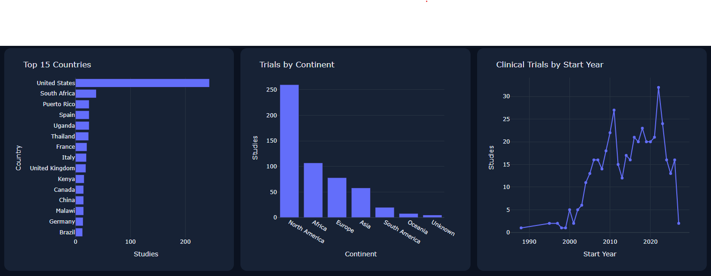

# HIV Clinical Trials Analytics Platform

**Clinical Research Analytics | Python | ClinicalTrials.gov API v2 | Model Context Protocol (MCP) | Plotly Dash**

An open-source research software prototype for exploring HIV clinical trial records through interactive visualizations, structured data analysis, and MCP-enabled analytical tools.

## 1. Project Overview

The HIV Clinical Trials Analytics Platform is a Python-based application that retrieves, processes, analyzes, and visualizes publicly available clinical trial records from ClinicalTrials.gov.

The platform combines two complementary interfaces:

- **Interactive Research Dashboard:** A Plotly Dash application for exploring clinical trial distributions, research trends, study characteristics, and geographic patterns.
- **Model Context Protocol (MCP) Server:** A programmatic interface that exposes clinical trial retrieval and analytical functions to compatible MCP clients.

The project demonstrates how public clinical research data can be transformed into accessible analytical information through API integration, modular software development, and interactive visualization.

## 2. Research Motivation

Clinical trial registries provide valuable information about medical research, including study locations, recruitment status, interventions, enrollment, and research timelines.

However, examining patterns across large collections of registered studies requires data retrieval, normalization, aggregation, and interpretation.

This project addresses that analytical challenge by providing a reusable workflow for exploring HIV clinical trial records.

Its primary objectives are to:

1. Simplify the retrieval and organization of publicly available HIV clinical trial information.
2. Support exploratory analysis of geographic research distributions and temporal trends.
3. Provide interactive visualizations that make research data easier to examine.
4. Expose analytical functions through MCP for integration with compatible software clients.
5. Demonstrate reproducible research software practices through modular code and automated testing.

The platform is intended to support research exploration and software experimentation. It does not assess treatment effectiveness, clinical outcomes, or regulatory compliance.

## 3. Key Features

### Clinical Trial Data Retrieval

- Retrieves clinical trial records using ClinicalTrials.gov API v2.
- Supports configurable search terms and record limits.
- Processes paginated API responses.
- Extracts structured information from registered studies.
- Records retrieval timestamps and identifies potentially truncated results.

### Geographic Analysis

- Counts distinct registered studies associated with individual countries.
- Aggregates study locations by continent.
- Supports comparisons of geographic research activity.
- Accounts for studies registered across multiple countries.

### Research Trend Analysis

- Summarizes registered studies by start year.
- Supports exploratory analysis of research activity over time.
- Provides visual representations of temporal distributions.

### Trial Characteristics

- Extracts study identifiers and titles.
- Retrieves recruitment and study status information.
- Organizes study types, phases, enrollment, and location information.
- Supports structured examination of available trial metadata.

### Interactive Visualization

- Interactive Plotly charts.
- Dashboard summary indicators.
- Search and filtering controls.
- Structured data tables.
- CSV export for further analysis.

### MCP Integration

- Exposes analytical functions as MCP tools.
- Supports structured retrieval of trial information.
- Returns geographic and temporal summaries.
- Provides chart-ready data for compatible clients.

## 4. Interactive Dashboard

The platform includes an interactive research dashboard developed using Plotly Dash.

### Dashboard Preview



*Interactive dashboard for exploring registered HIV clinical trials using publicly available ClinicalTrials.gov data.*

### Dashboard Capabilities

| Feature | Description |
|---|---|
| Study retrieval | Retrieve clinical trial records using configurable search parameters. |
| Summary metrics | Display key indicators from retrieved records. |
| Country analysis | Visualize registered studies associated with individual countries. |
| Continent analysis | Compare geographic distributions across continents. |
| Research trends | Examine registered studies by start year. |
| Study status | Explore recruitment and study status distributions. |
| Interactive exploration | Use charts, filters, and tables to examine available records. |
| CSV export | Export dashboard data for additional analysis. |

The dashboard retrieves data from ClinicalTrials.gov rather than relying on a fixed dataset.

Results depend on the search query, retrieval date, available registry information, and selected record limit.

## 5. System Architecture

The application follows a modular architecture that separates data retrieval, analytical processing, visualization, and MCP-based access.

### Architecture Overview

```text
                 ClinicalTrials.gov API v2
                            |
                            v
                   Data Retrieval Layer
                            |
                            v
                 src/clinical_trials.py
                (Normalization & Analysis)
                            |
               +------------+------------+
               |                         |
               v                         v
         dashboard.py               mcp_server.py
        (Plotly Dash)              (MCP Interface)
               |                         |
               v                         v
       Interactive Charts         Compatible MCP Clients
       Filters & Tables           Structured Tool Results
       CSV Export                 Analytical Data Access
```

### Core Components

| File or Directory | Responsibility |
|---|---|
| `src/clinical_trials.py` | API retrieval, normalization, study lookup, geographic aggregation, and yearly summaries. |
| `dashboard.py` | Interactive dashboard, visualizations, filters, tables, and data export. |
| `mcp_server.py` | MCP server and registered analytical tools. |
| `tests/test_analysis.py` | Automated tests for analytical functions. |
| `notebooks/original_Clinical_Trials.ipynb` | Original exploratory research notebook. |
| `screenshots/` | Dashboard images used in project documentation. |
| `requirements.txt` | Python package dependencies. |

### Analytical Workflow

1. Submit a search query to ClinicalTrials.gov API v2.
2. Retrieve available study records through paginated API requests.
3. Normalize selected clinical trial fields into structured Python objects.
4. Calculate geographic distributions and temporal summaries.
5. Present analytical results through the dashboard or MCP tools.
6. Support additional exploration through structured outputs and CSV export.

Separating analytical functions from presentation interfaces improves code reuse, maintainability, and testability.

## 6. Technology Stack

| Technology | Application |
|---|---|
| Python | Application development and analytical processing |
| ClinicalTrials.gov API v2 | Public clinical trial data retrieval |
| Requests | HTTP communication with the API |
| Pandas | Data processing and tabular analysis |
| Plotly | Interactive visualizations |
| Dash | Web-based analytical dashboard |
| MCP Python SDK | Model Context Protocol server |
| Pycountry-convert | Country-to-continent mapping |
| Pytest | Automated software testing |
| Git and GitHub | Version control and source code publication |

## 7. Installation and Setup

### Prerequisites

- Python 3.10 or later
- Git
- Internet access to retrieve ClinicalTrials.gov records

### Clone the Repository

```bash
git clone https://github.com/Starfranklyn/hiv-clinical-trials-mcp-analytics.git
cd hiv-clinical-trials-mcp-analytics
```

### Create a Virtual Environment

```bash
python -m venv .venv
```

Activate the environment.

**Windows PowerShell:**

```powershell
.\.venv\Scripts\Activate.ps1
```

**macOS/Linux:**

```bash
source .venv/bin/activate
```

### Install Dependencies

```bash
python -m pip install -r requirements.txt
```

## 8. Running the Interactive Dashboard

Start the dashboard from the project directory:

```bash
python dashboard.py
```

Open the local address displayed in the terminal.

The dashboard provides an interface for retrieving and exploring clinical trial records.

**Note:** The dashboard runs locally. The GitHub repository hosts the source code and documentation, not a publicly deployed dashboard.

## 9. Running the MCP Server

Start the MCP server:

```bash
python mcp_server.py
```

The server uses standard input/output (stdio) transport.

It does not launch a web page. Instead, it communicates with compatible MCP clients.

### Example MCP Client Configuration

Replace the paths below with the absolute paths on your computer.

```json
{
  "mcpServers": {
    "hiv-trials": {
      "command": "/absolute/path/to/.venv/bin/python",
      "args": [
        "/absolute/path/to/hiv-clinical-trials-mcp-analytics/mcp_server.py"
      ]
    }
  }
}
```

On Windows, use the absolute path to `.venv\Scripts\python.exe`.

The MCP server can also be inspected and tested using compatible MCP development tools.

## 10. Available MCP Tools

| MCP Tool | Function |
|---|---|
| `search_hiv_trials(max_records, status)` | Retrieves and normalizes HIV clinical trial records, with optional status filtering of the retrieved sample. |
| `trial_details(nct_id)` | Retrieves information for a specific registered study using its NCT identifier. |
| `trials_by_country(max_records)` | Counts distinct registered studies by country. |
| `trials_by_continent(max_records)` | Aggregates distinct registered studies by continent. |
| `hiv_trial_trends(max_records)` | Summarizes retrieved studies by start year. |
| `country_chart_data(max_records, top_n)` | Returns chart-ready country labels and study counts. |

MCP tools return structured analytical information. Chart rendering depends on the capabilities of the connected client.

## 11. Testing and Reproducibility

The project includes automated tests for selected analytical functions.

Run the test suite using:

```bash
python -m pytest -q
```

The current local development version has passed five automated tests.

The modular structure supports independent testing of analytical logic without requiring the dashboard or MCP server to run simultaneously.

For reproducible research, users should document:

- Search terms and retrieval dates.
- Maximum records requested.
- Applied filters.
- Data completeness and missing fields.
- Geographic counting assumptions.
- Software and dependency versions.

Because ClinicalTrials.gov records may change over time, repeated queries can produce different results.

## 12. Data Source and Analytical Limitations

### Data Source

The application retrieves publicly available study records from ClinicalTrials.gov API v2.

ClinicalTrials.gov is maintained by the U.S. National Library of Medicine at the National Institutes of Health.

### Important Limitations

**Record limits:** The application supports bounded data retrieval. Analyses may represent partial samples rather than the complete registry.

**Geographic interpretation:** Country and continent counts represent registered studies associated with those locations, not participant enrollment, disease prevalence, or healthcare access.

**Multicountry studies:** A single study may contribute to multiple geographic categories. Therefore, geographic totals may exceed the number of distinct studies.

**Registry updates:** Study information can change as registry records are updated.

**Missing information:** Not all records contain complete location, enrollment, intervention, or study timeline information.

**Search coverage:** Results depend on the search terms and fields indexed by ClinicalTrials.gov.

**Research validity:** Descriptive patterns do not establish causal relationships, intervention effectiveness, or differences in disease burden.

These limitations should be considered before interpreting or publishing analytical findings.

## 13. Research Applications

The platform demonstrates technical approaches that may be useful in:

- Clinical research informatics.
- Public health data exploration.
- Clinical trial registry analysis.
- Research data visualization.
- Reproducible analytical workflows.
- API-based research software development.
- MCP-enabled analytical applications.

The project also provides a foundation for investigating how structured research data can be made more accessible through interactive and programmatic interfaces.

### Future Development

Potential extensions include:

- More advanced clinical trial search and filtering.
- Additional study characteristics and intervention analyses.
- Expanded data quality checks.
- Improved visualization and dashboard accessibility.
- Exportable analytical reports.
- More comprehensive automated testing.
- Deployment options for controlled research environments.

These are potential development directions, not features claimed to be implemented in the current release.

## 14. Research Disclaimer

This project is an independent research software prototype.

It is not affiliated with, sponsored by, or endorsed by the U.S. Food and Drug Administration, the National Institutes of Health, or ClinicalTrials.gov.

The platform is intended for exploratory research and educational use.

It is not a clinical decision-support system and should not be used to make treatment, diagnostic, regulatory, or patient-care decisions.

Users should independently verify source data, analytical assumptions, and findings before using results in formal research or publications.